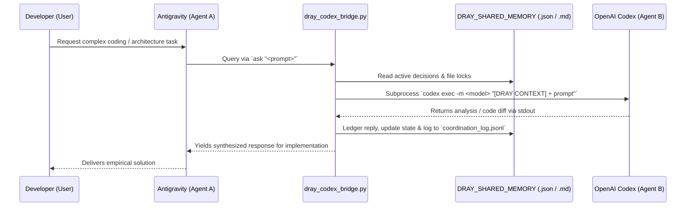

# 🔗 Dray Multi-Agent Linker Bridge: Architecture & Setup Guide

This document details the operational mechanics, communication protocol, dependencies, and synchronization capabilities of the **Dray Multi-Agent Linker Bridge** connecting **Google DeepMind Antigravity** and **OpenAI Codex** (Desktop and Cloud sessions).

---

## 1. How the Bridge Starts

The Dray bridge operates as a lightweight, cross-platform CLI sidecar (`dray_codex_bridge.py`).

### Startup Modes & Commands:
```bash
# 1. Health & State Audit
python dray_codex_bridge.py status

# 2. Memory State Synchronization
python dray_codex_bridge.py sync --summary "<Prompt Summary>" --action "<Action Summary>"

# 3. Direct Query to Codex
python dray_codex_bridge.py ask "<prompt>" --model gpt-6.1-sol

# 4. Multi-Model Consensus (Parallel Dispatch)
python dray_codex_bridge.py ask "<prompt>" --multi

# 5. File Ownership Lock Governance
python dray_codex_bridge.py lock "<path>" --owner Antigravity
python dray_codex_bridge.py unlock "<path>"
```

### Environment Configuration:
The bridge dynamically resolves runtime paths using environment variables with intelligent fallbacks:
| Variable | Description | Default Fallback |
| :--- | :--- | :--- |
| `CODEX_HOME_DIR` | Working directory for Codex state and shared memory | `~/.codex` (or `%USERPROFILE%\.codex`) |
| `CODEX_BIN` | Path to the `codex` CLI executable | Auto-discovered in `PATH`, `%LOCALAPPDATA%`, or `/usr/local/bin` |
| `ANTIGRAVITY_CONFIG_DIR` | Antigravity global configuration root | `~/.gemini/config` |
| `ANTIGRAVITY_CONV_ID` | Active session conversation identifier | Auto-detected |
| `DRAY_SYNC_CHAT_HISTORY` | Enable/disable conversation history syncing | `false` (Disabled by default) |

---

## 2. How Messages Are Exchanged

The Dray protocol implements a **file-backed shared memory bus with child process IPC execution**:



### Protocol Artifacts:
1. `DRAY_SHARED_MEMORY.json`: Authoritative machine-readable state storing agent definitions, verified decisions, and active file locks.
2. `DRAY_SHARED_MEMORY.md`: Human-readable distilled summary injected into Codex's context via `AGENTS.md`.
3. `CODEX_REPLY.md`: Dedicated buffer holding the latest raw response or multi-model synthesis from Codex.
4. `coordination_log.jsonl`: Append-only audit trail logging timestamps, models, prompts, and output excerpts.

### File Ownership Invariants:
To prevent write conflicts, agents must acquire an exclusive lock before modifying files:
- Lock: `python dray_codex_bridge.py lock "path/to/file.ext" --owner "<AgentName>"`
- The opposing agent inspects `active_file_locks` in `DRAY_SHARED_MEMORY.md` and yields write authority.

---

## 3. Dependencies

- **Python Runtime**: Python 3.10 or higher.
- **Standard Library Only**: Built entirely on built-in modules (`os`, `sys`, `json`, `shutil`, `subprocess`, `datetime`, `argparse`, `concurrent.futures`). **Zero third-party pip packages required.**
- **Codex CLI**: Requires either the OpenAI Codex Desktop CLI binary (`codex.exe` / `codex`) or a cloud container with `codex` installed in the system `PATH`.

---

## 4. Chat History Sync Status & Privacy Architecture

### Current Status: 🔒 DISABLED BY DEFAULT
To protect proprietary code and private project details from being exported to public repositories or unencrypted endpoints, **chat history syncing is strictly disabled by default** (`CHAT_HISTORY_SYNC_ENABLED = false`).

### How It Works While Disabled:
- The bridge synchronizes only **high-level approved architectural decisions** and **active file locks**.
- `shared_message_history` remains completely empty in `DRAY_SHARED_MEMORY.json` and `.md`.
- No user conversation turns, personal prompts, or project transcripts are passed into the shared memory or written to disk.

### Configuring a Private Destination (Future Activation):
When ready to enable full multi-turn conversation synchronization:
1. Establish a private, authenticated storage endpoint or private Git repository accessible exclusively to the authorized agents.
2. Set the environment variable:
   ```bash
   export DRAY_SYNC_CHAT_HISTORY=true
   ```
3. Once enabled, the bridge will record a rolling window of recent interaction summaries to `shared_message_history` for multi-turn context retention across sessions.
